<a href="https://bhaskar.amurot.com">
  
</a>

  
  <a href="https://bhaskar.amurot.com/BhaskarPatelResume.pdf">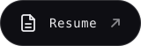</a>
  
  

 

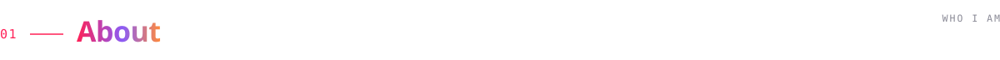

I'm **Bhaskar**, an Android developer and product builder from Raigarh, India. Most of my time goes into writing **Kotlin**, designing with **Jetpack Compose**, and figuring out how to make software feel effortless.

I founded **[Amurot](https://amurot.com)** to build calm, fast tools that solve real problems, starting with **[Linkerly](https://linkerly.amurot.com)**. I'm also a **Smart India Hackathon 2025 national winner** with Team Data CodeBlitz.

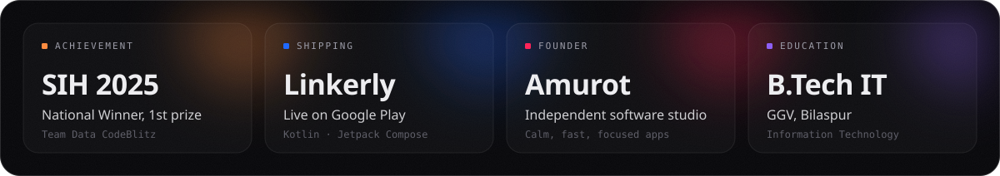

 

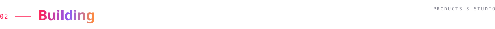

  <a href="https://linkerly.amurot.com">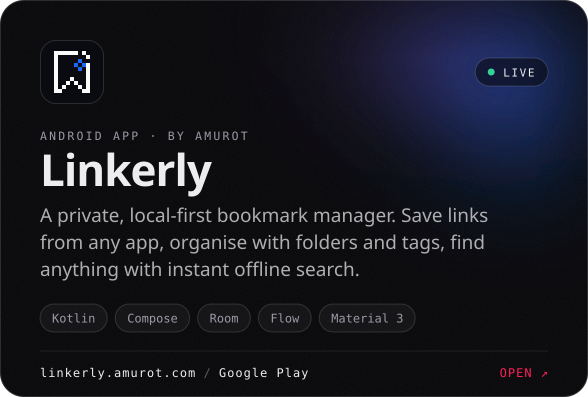</a>
  <a href="https://amurot.com">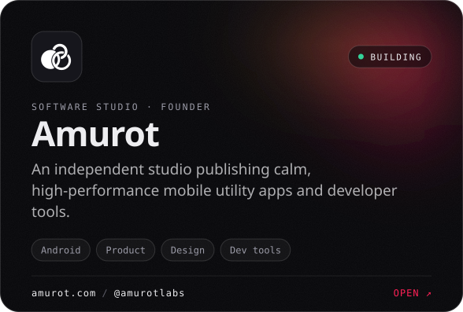</a>

Get Linkerly on <a href="https://play.google.com/store/apps/details?id=com.amurot.linkerly">Google Play</a> · Amurot on <a href="https://www.youtube.com/@amurotlabs">YouTube</a> and <a href="https://github.com/amurot-labs">GitHub</a>

  

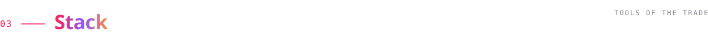

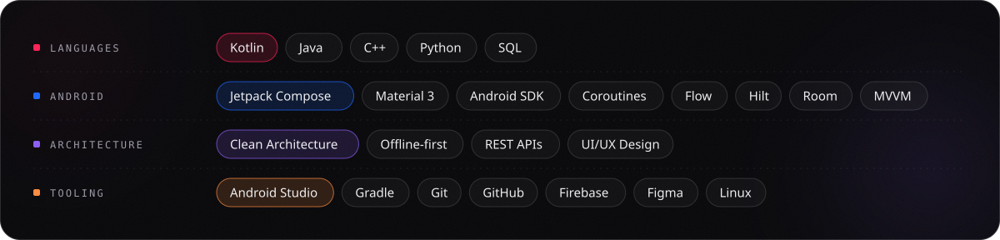

 

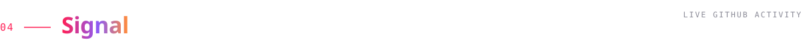

  
  

 

<a href="mailto:bhaskar@amurot.com">
  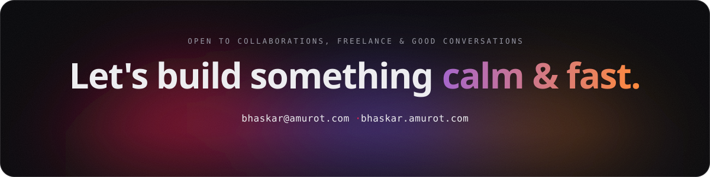
</a>
